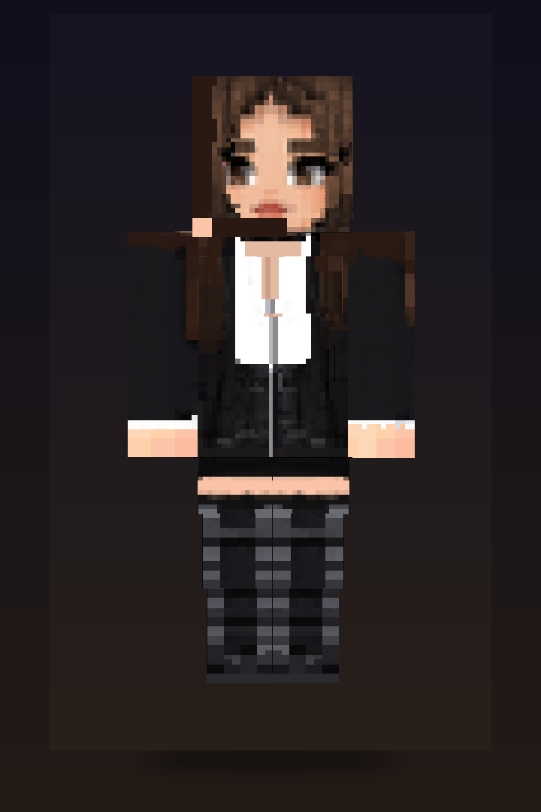

# Project Vika

<p align="center">
  
</p>

<p align="center">
  <strong>Vika</strong> — an office colleague who somehow ended up in Minecraft.<br/>
  She follows you, talks back, and does not do “cute companion” energy.
</p>

<p align="center">
  <a href="https://github.com/l7cor1s/project-victoria/raw/cursor/viktoria-companion-scaffold-3c34/dist/viktoria-neoforge-1.21.1-0.2.0.jar"></a>
  
  
</p>

**[⬇ Download viktoria-neoforge-1.21.1-0.2.0.jar](https://github.com/l7cor1s/project-victoria/raw/cursor/viktoria-companion-scaffold-3c34/dist/viktoria-neoforge-1.21.1-0.2.0.jar)**

NeoForge **1.21.1** companion mod. Adaptation of [My Girlfriend Laura](https://github.com/laforetbrut/mods-mc-laura) (Apache-2.0).

The GitHub page is English. The mod itself is **bilingual (English + Russian)** — UI strings and dialogue packs ship for both languages.

---

## Character


Self-assured, sarcastic, sharp. Hidden interest under the attitude — not a sweet sidekick.

Embedded look (rendered above from `Vika.geo.json` + `Vika.png`):

| File | Role |
|------|------|
| `docs/art/vika-hero.png` | Full-body model preview (README hero) |
| `docs/art/vika-fullbody.png` | Same render, cropped |
| `docs/art/vika-face.png` | Face close-up from the 256×256 skin |
| `assets/viktoria/vika_models/Vika.*` | In-game geo / animation / texture / bbmodel |

---

## Features

- **Unique companion** — only one Vika in the world
- **Natural spawn** on first join (`summoning.naturalSpawn`) or `/vika summon` (teleports if she already exists)
- **TIMER revive** by default after death
- Follow, menu, gifts, jobs, emotes, skins — Laura systems, rebranded
- Follow radius: `follow.radius` in `config/projectvika/projectvika-common.json`
- Extra models: `config/projectvika/models/uploads/`
- Default model hardcoded: `pack:Vika`

### Commands

- `/vika summon` — bring her to you (aliases: `/viktoria`, `/laura`)
- Or craft / use **Vika's Heart**

---

## Languages

| | |
|--|--|
| **English** | `en_us` UI + dialogues |
| **Russian** | `ru_ru` UI + dialogues (office / sarcasm tone) |

Set your Minecraft language as usual; Vika follows it (with English fallback).

---

## Build

```bash
./gradlew build
```

Output: `build/libs/viktoria-neoforge-1.21.1-0.2.0.jar` (also copied to [`dist/`](dist/)).

---

## License

Apache-2.0. Upstream Laura © vyrriox. Adaptation © l7cor1s.
