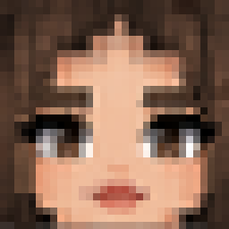
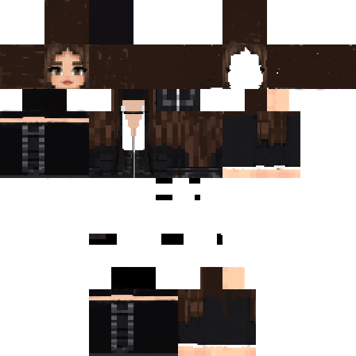
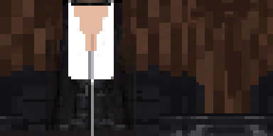

# Project Vika (Вика)

NeoForge **1.21.1** companion: office colleague **Вика**.  
Adaptation of [My Girlfriend Laura](https://github.com/laforetbrut/mods-mc-laura) (Apache-2.0).

## Art







Embedded model: `assets/viktoria/vika_models/Vika.{geo.json,animation.json,png}` (256×256, Classic UV space 64).

## Build

```bash
./gradlew build
```

Jar: `build/libs/viktoria-neoforge-1.21.1-0.2.0.jar` (also `dist/`).

## Play

- Unique companion: only one Vika in the world
- Natural spawn on first join (`summoning.naturalSpawn` in config) or `/vika summon` (teleports if she already exists)
- Death: TIMER revive by default (`general.reviveMode`)
- Follow radius: `follow.radius` in `config/projectvika/projectvika-common.json`
- Extra models: `config/projectvika/models/uploads/`

## Character

Самоуверенная стерва из офиса: сарказм, подколы, скрытый интерес. Не «милый компаньон».  
Диалоги: `data/viktoria/dialogues/ru_ru.json`.

## License

Apache-2.0. Upstream Laura © vyrriox. Adaptation © l7cor1s.
